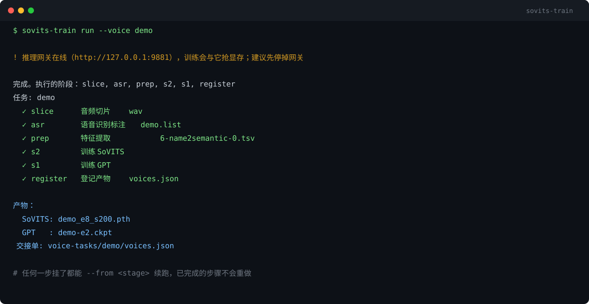

# gpt-sovits-trainer

**GPT-SoVITS 训练编排器**：一条命令，从「一段录音」到「推理网关里能直接用的音色」。

[](LICENSE)
[](https://github.com/zyqchanel-06/gpt-sovits-trainer/releases)
[](https://www.python.org/)



---

## 它解决什么问题

给 GPT-SoVITS 训一个新音色，官方 WebUI 里的真实步骤是这样的：

```
切片 → ASR 标注 → 人工校对 → 文本特征 → SSL 特征 → 语义特征 → 训 SoVITS → 训 GPT → 挑权重
```

九个步骤，每步都要填参数、看日志、确认产物。中途挂一次（OOM、断电、Ctrl+C），
下次就得凭记忆判断「跑到哪了、哪些能复用」。

这个工具把这条链**固化成流水线**：

- 六步状态机，每步完成即写盘，挂了从断点续跑
- 参数集中在一次调用里，不用记九条命令
- 产物自动命名并扫描，训完直接生成网关能吃的配置
- 全程 **subprocess 调 GPT-SoVITS 官方脚本**，不重写任何训练逻辑

## 和 gpt-sovits-gateway 的关系

```
这个仓库（训练）                gpt-sovits-gateway（推理）
录音 ──→ .pth + .ckpt ──sync──→ config.json 里的一个 voice ──→ OpenAI 兼容 API
```

两个仓库相互独立，只靠一份 `voices.json` / 网关配置交接。也可以只用这个训练器，
权重拿去官方 WebUI 用。

## 安装

```bash
pip install "gpt-sovits-trainer @ git+https://github.com/zyqchanel-06/gpt-sovits-trainer.git"
# 或者：
git clone https://github.com/zyqchanel-06/gpt-sovits-trainer.git && cd gpt-sovits-trainer
pip install -e .
```

唯一依赖是 **PyYAML**（GPT-SoVITS 环境里本来就有）。

前置条件：

1. 一份 **GPT-SoVITS** 仓库（含 `webui.py` 和 `GPT_SoVITS/`）
2. 该仓库的 Python 环境能跑训练（有 torch / CUDA）
3. 训练脚本需要的预训练权重已经下载好

## 快速开始

```bash
# 1. 先体检，确认路径和环境
sovits-train doctor --gpt-sovits-root "E:/path/to/GPT-SoVITS-main"

# 2. 建任务（指定录音，10 秒到 1 小时的音频都行）
sovits-train --gpt-sovits-root "E:/path/to/GPT-SoVITS-main" \
    init --voice alice --audio ./recordings/alice.mp3

# 3. 跑完整流水线
sovits-train --gpt-sovits-root "E:/path/to/GPT-SoVITS-main" run --voice alice

# 4. 看进度（任何时候都能查）
sovits-train --gpt-sovits-root "E:/path/to/GPT-SoVITS-main" status --voice alice

# 5. 写进推理网关
sovits-train --gpt-sovits-root "E:/path/to/GPT-SoVITS-main" \
    sync --voice alice --gateway ../gpt-sovits-gateway/config.json
```

跑完 `sync`，网关的 `config.json` 里就多了一条 voice，重启网关就能用
`{"input":"你好","voice":"alice"}` 合成。

## 六步流水线

| # | 阶段 | 干什么 | 产物 |
| --- | --- | --- | --- |
| 1 | `slice` | 按静音把长录音切成 3~10 秒片段 | `tasks/<voice>/slice/wav/*.wav` |
| 2 | `asr` | 语音识别生成标注（可跳过，用现成 `.list`） | `*.list` |
| 3 | `prep` | 文本/SSL/语义三种特征提取（三个脚本） | `2-name2text.txt` / `4-cnhubert/` / `6-name2semantic.tsv` |
| 4 | `s2` | 训练 SoVITS（音色音质分支） | `<voice>_e<N>_s<M>.pth` |
| 5 | `s1` | 训练 GPT（韵律语义分支） | `<voice>-e<N>.ckpt` |
| 6 | `register` | 扫描产物、挑最优、写交接单 | `tasks/<voice>/voices.json` |

任何一步失败，状态文件里会记下错误；修好后 `run` 会从失败那步继续，不会重跑已完成的。

## 常用命令

```bash
sovits-train init   --voice <名字> --audio <录音或目录> [--list <标注>] [--language zh]
sovits-train run    --voice <名字> [--only s2] [--from prep] [--force] [--verbose]
sovits-train status [--voice <名字> | --all]
sovits-train list
sovits-train reset  --voice <名字> --stage s2      # 重置该步及之后
sovits-train export --voice <名字> [--epoch 4]     # 重新登记（换 epoch 档位）
sovits-train sync   --voice <名字> --gateway <config.json>
sovits-train doctor
```

### 训练参数

`run` 支持临时覆盖：

| 参数 | 默认 | 说明 |
| --- | --- | --- |
| `--s2-epochs` / `--s1-epochs` | 各 8 | 训练轮数（10 秒素材训 4~8 轮通常够） |
| `--s2-batch-size` / `--s1-batch-size` | 各 4 | 显存不够就调小 |
| `--save-every-epoch` | 4 | 每隔几轮存一个权重档位 |

## 配置

不想每次写 `--gpt-sovits-root`，就在当前目录放一个 `.sovits-trainer.json`：

```json
{
  "gpt_sovits_root": "E:/DeepSeekHarness/tts/GPT-SoVITS-main",
  "python": "C:/Python311/python.exe",
  "work_root": "./voice-tasks",
  "version": "v2",
  "is_half": true,
  "cuda_visible": "0"
}
```

也可以用环境变量 `GPT_SOVITS_ROOT`。查找优先级：
**命令行 > 环境变量 > 当前目录配置 > 常见安装位置**。

## 显存提醒

训练和推理抢同一块卡是这类流水线最常见的翻车点。`run` 之前会自动检查：

- 显存占用超过一半 → 警告
- 推理网关在线 → 提醒先停掉

这些只是提醒，不阻止执行（你可能就是想边跑边测）。

## 已知边界

- **只支持 v1 / v2**：v3 / v4 / v2Pro 的模板和权重路径不一样，目前没适配
- **ASR 精度有限**：faster-whisper 对专有名词容易错，跑完 `asr` 建议人工校对 `.list`
- **不做声音克隆的伦理判断**：请确保你有权使用素材里的声音，别拿去冒充真人
- **CPU 训练**：技术上可行，但慢到不实用

## 测试

```bash
python -m unittest discover -s tests -v
```

26 个用例全部 dry-run（造一个假的 GPT-SoVITS 目录结构），**不需要显卡、不需要真训练**。

## License

MIT —— 见 [LICENSE](LICENSE)。